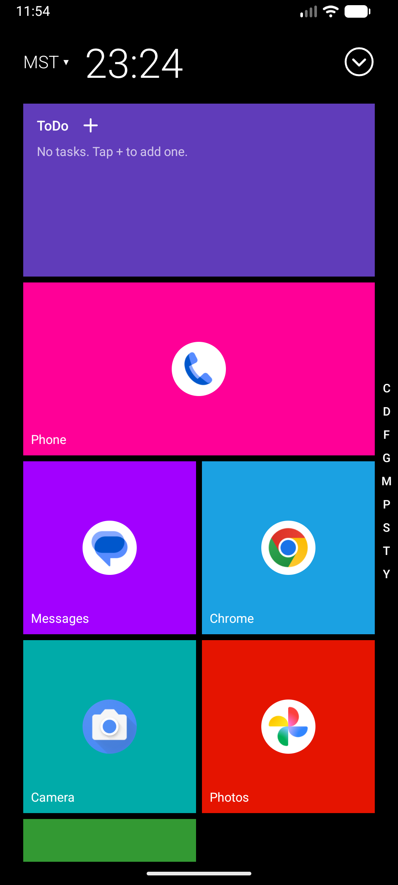
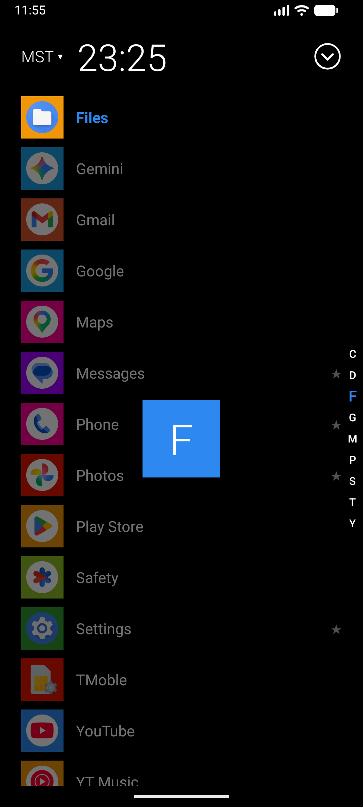
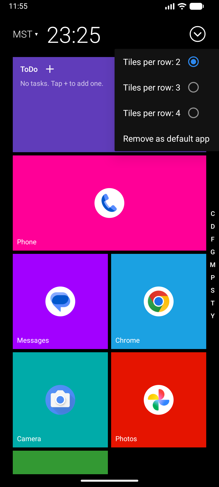

# customUIlauncher

A Windows 8 / Metro-style home screen launcher for Android.

## What's new in 1.0.2

- **Cinematic tile zoom when opening an app** – tap a tile and Start rushes past the camera:
  the tapped tile swells while every other tile enlarges, fades and is pushed outward from it
  in a ripple.
- **Zoom-out when returning home** – coming back from any app reverses the effect. The tile you
  launched from settles first, as if the app shrinks back into it, then the rest of Start
  (tiles, header and index bar) glides into place, nearest first.
- **Android 14 support** – the minimum version is now Android 14 (API 34), down from 15.
- **New app icon** – the Doom Launcher rocket logo replaces the default Android icon.

Android 14+ uses its own window transition when an app opens or closes; the zoom effects play
on Start's tiles together with it.

## What's new in 1.0.1

- **Alphabet index bar** on the right edge of Start. It lists only the characters your apps
  start with (`#` for names starting with a digit). Touch or drag it to open the app list,
  jump to that letter and highlight its apps; the selected letter grows and a large preview
  appears while you drag.
- **App list hidden by default** – the index bar opens it, Back or Home closes it. The
  separate show/hide arrow button is gone.
- **New options button** – the menu now opens from the circle-chevron button at the top right.
- App renamed to **Doom Launcher**.

<p>
  
  
  
</p>

## Features

- **Live tile grid** – pin apps to Start as tiles; long-press a tile to resize it
  (drag the corner), move it to the front, or unpin it.
- **To-do tile** – a built-in tile for quick tasks: add, edit, check off and delete.
- **All apps** – the app list below the tiles is hidden by default. Touch or drag the
  **index bar** on the right edge (`#` for digits, then only the letters that have apps) to
  reveal the list, jump to that letter and highlight its apps. Back or Home hides it again.
  Long-press an app to pin it, open App info, or uninstall.
- **World clock header** – the header shows a time-zone selector (default **MST**) with the
  current time beside it in 24-hour format. Tap the zone to pick another one; the choice is saved.
- **Options menu** (circle button, top right) – choose 2, 3 or 4 tiles per row, restore the to-do tile, and set or
  remove the launcher as the default home app.

## Requirements

- Android 14 (API 34) or newer
- Android Studio with JDK 17+

## Build & run

```sh
./gradlew :app:assembleDebug        # build the debug APK
./gradlew :app:installDebug         # install on a connected device/emulator
```

Then press Home and choose **Doom Launcher**, or open the app and use
the **circle button → Set as default**.

## Project layout

| File | Purpose |
|------|---------|
| `LauncherActivity.java` | Home screen, header clock, menus, to-dos |
| `StartAdapter.java` / `TileGridLayout.java` | Tile grid and app list rendering |
| `TileZoomAnimator.java` | Per-tile zoom when launching apps and returning home |
| `AppRepository.java` | Loads installed launchable apps |
| `LauncherStore.java` | Persists pins, to-dos and settings |
| `MetroColors.java` | Tile colours |
